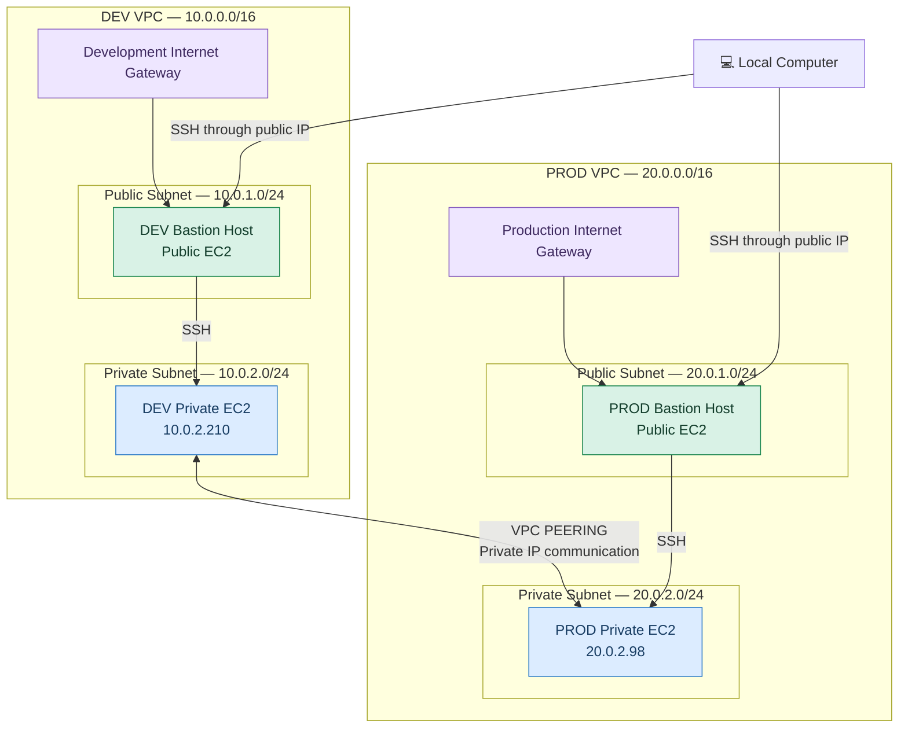

# ☁️ AWS Multi-VPC Peering & Bastion Host Architecture

**Building secure communication between Development and Production networks using Amazon VPC, EC2, VPC Peering, and Bastion Hosts.**

<p align="center">
  
  
  
  
</p>

---

## 📌 1. About This Project

In this project, I built a network architecture using **two separate AWS Virtual Private Clouds (VPCs)**:

- **Development VPC:** Used for development resources.
- **Production VPC:** Used for production resources.

Both VPCs have their own public and private subnets. Public Bastion Hosts provide controlled SSH access to private EC2 instances.

I connected both VPCs using an **AWS VPC Peering Connection**, allowing private instances to communicate with each other through private IP addresses.

The main purpose of this project is to understand how AWS networking works and how to establish secure communication between separate cloud networks.

## 🎯 2. Project Goals

By completing this project, I learned how to:

- Create and configure multiple VPCs.
- Divide networks into public and private subnets.
- Configure Internet Gateways.
- Create and manage route tables.
- Establish VPC Peering connections.
- Deploy EC2 instances in different subnets.
- Configure Bastion Hosts for secure SSH access.
- Control network traffic using Security Groups.
- Test communication between private instances in different VPCs.

---

## 🏗️ 3. Network Architecture

The architecture contains two independent VPCs connected through a VPC Peering Connection.

### Architecture Diagram



### How the Architecture Works

| Component | Purpose |
|---|---|
| Development VPC | Holds development resources |
| Production VPC | Holds production resources |
| Public Subnet | Contains publicly reachable Bastion Hosts |
| Private Subnet | Contains backend EC2 instances |
| Internet Gateway | Provides internet connectivity to public subnets |
| Bastion Host | Provides controlled SSH access to private instances |
| VPC Peering | Connects the two VPC networks privately |
| Route Tables | Direct traffic to the correct network destination |
| Security Groups | Control which network traffic is allowed |

**Important:** The private instances do not need public IP addresses to communicate through VPC Peering.

---

## 🌐 4. IP Address Planning

The following table shows the IP addressing plan used in this project.

| AWS Resource | Name | CIDR / Private IP |
|---|---|---|
| Development VPC | dev-vpc | 10.0.0.0/16 |
| Development Public Subnet | dev-public-subnet | 10.0.1.0/24 |
| Development Private Subnet | dev-private-subnet | 10.0.2.0/24 |
| Development Private EC2 | dev-private | 10.0.2.210 |
| Production VPC | prod-vpc | 20.0.0.0/16 |
| Production Public Subnet | prod-public-subnet | 20.0.1.0/24 |
| Production Private Subnet | prod-private-subnet | 20.0.2.0/24 |
| Production Private EC2 | prod-private | 20.0.2.98 |

*The private IP addresses above are example addresses from the project configuration.*

---

## ⚙️ 5. AWS Resources Used

| AWS Service | Implementation |
|---|---|
| Amazon VPC | Two separate virtual networks |
| Amazon EC2 | Four virtual machines |
| Internet Gateway | One for each VPC |
| VPC Peering | Private connection between VPCs |
| Route Tables | Public and private routing |
| Security Groups | SSH and ICMP traffic control |
| Ubuntu Linux | Operating system for EC2 instances |

---

## 🔧 6. Implementation Steps

The project was configured using the AWS Management Console.

### Step 1 — Create Two VPCs

Create the following VPCs:

- `dev-vpc` — `10.0.0.0/16`
- `prod-vpc` — `20.0.0.0/16`

Both VPCs use different CIDR ranges to avoid IP address conflicts.

### Step 2 — Create Public and Private Subnets

Create two subnets inside each VPC.

**Development:**
- `dev-public-subnet`
- `dev-private-subnet`

**Production:**
- `prod-public-subnet`
- `prod-private-subnet`

### Step 3 — Configure Internet Gateways

Create and attach:

- `dev-igw`
- `prod-igw`

These gateways provide internet connectivity to the public subnets through their route tables.

### Step 4 — Configure Route Tables

Create four route tables:

- `dev-public-rt`
- `dev-private-rt`
- `prod-public-rt`
- `prod-private-rt`

Public route tables use the Internet Gateway as the default route.

Private route tables initially contain their respective local VPC routes.

### Step 5 — Establish VPC Peering

Create a peering connection between:

- Requester: `dev-vpc`
- Accepter: `prod-vpc`

Accept the request and wait until the connection status becomes `Active`.

### Step 6 — Add Peering Routes

Add the following routes:

**Development Private Route Table**

| Destination | Target |
|---|---|
| 20.0.0.0/16 | VPC Peering Connection |

**Production Private Route Table**

| Destination | Target |
|---|---|
| 10.0.0.0/16 | VPC Peering Connection |

These routes allow traffic to travel between the two private networks.

### Step 7 — Launch EC2 Instances

Launch four Ubuntu EC2 instances:

- Development Bastion Host
- Development Private EC2
- Production Bastion Host
- Production Private EC2

Assign public IP addresses only to the Bastion Hosts.

### Step 8 — Configure Security Groups

Configure Bastion Security Groups to allow SSH from your own public IP address.

Configure private instance Security Groups to allow:

- SSH from the appropriate Bastion Security Group.
- ICMP traffic from the remote VPC CIDR for connectivity testing.

This prevents unnecessary exposure of private resources.

---

## 🔐 7. Connect to Private EC2 Instances

Instead of uploading a private SSH key to the Bastion Host, use SSH ProxyJump.

From your local terminal:

```bash
ssh -i "key.pem" \
-J ubuntu@<DEV_PUBLIC_BASTION_IP> \
ubuntu@10.0.2.210
```

This connects to the Development private instance through the Development Bastion Host.

Your private SSH key remains on your local computer.

---

## 🧪 8. Cross-VPC Connectivity Testing

After connecting to the Development private instance, test communication with the Production private instance.

Run:

```bash
ping -c 4 20.0.2.98
```

### Expected Result

```text
PING 20.0.2.98 (20.0.2.98) 56(84) bytes of data.

64 bytes from 20.0.2.98: icmp_seq=1 ttl=64 time=1.24 ms
64 bytes from 20.0.2.98: icmp_seq=2 ttl=64 time=0.98 ms
64 bytes from 20.0.2.98: icmp_seq=3 ttl=64 time=1.02 ms
64 bytes from 20.0.2.98: icmp_seq=4 ttl=64 time=1.02 ms

4 packets transmitted, 4 received, 0% packet loss
```

<details>
<summary><b>What does this result mean?</b></summary>

- The Development private instance can reach the Production private instance.
- The traffic is using private IP addresses.
- VPC Peering routes are working.
- The Security Groups and operating-system firewall permit the ICMP traffic.

</details>

---

## 🛡️ 9. Security Considerations

Security is an important part of this architecture.

The following practices were considered:

- Private EC2 instances do not have public IP addresses.
- SSH access to Bastion Hosts is restricted to your own IP.
- Private SSH access is restricted to Bastion Hosts.
- ICMP access is limited to the remote VPC CIDR.
- Private SSH keys are not copied to Bastion Hosts.
- Private network communication uses VPC Peering.

**Architecture limitation:** This is a hands-on learning project, not a complete production deployment. Production environments should also consider high availability, monitoring, logging, automated deployment and centralized access management.

---

## 📚 10. What I Learned

Through this project, I gained practical experience with:

- AWS VPC networking.
- Public and private subnet configuration.
- Internet Gateway configuration.
- Route table management.
- VPC Peering.
- EC2 instance deployment.
- Bastion Host configuration.
- SSH and Linux administration.
- Security Group configuration.
- Private cross-VPC communication.
- Basic AWS network troubleshooting.

---

## 🚀 11. Future Improvements

I plan to extend this project with:

- Terraform-based infrastructure deployment.
- Multi-Availability Zone architecture.
- AWS Systems Manager Session Manager.
- VPC Flow Logs and CloudWatch monitoring.
- Automated infrastructure configuration using Ansible.
- Improved network security and monitoring.

---

## 🧹 12. AWS Resource Cleanup

To avoid unnecessary AWS charges, remove the resources after completing the project.

1. Terminate the EC2 instances.
2. Delete the VPC Peering Connection.
3. Delete custom route tables.
4. Detach and delete Internet Gateways.
5. Delete Security Groups.
6. Delete subnets.
7. Delete both VPCs.
8. Check for remaining Elastic IPs, EBS volumes and other billable resources.

---

## 👨‍💻 Project Information

**Project:** AWS Multi-VPC Peering & Bastion Host Architecture

**Platform:** Amazon Web Services (AWS)

**Configuration Method:** AWS Management Console

**Operating System:** Ubuntu Linux

**Main Services:** VPC, EC2, Internet Gateway, VPC Peering, Route Tables and Security Groups.

**Purpose:** Hands-on AWS Cloud Networking and Infrastructure Learning.

---

⭐ If you find this project useful, feel free to explore it and learn from the implementation.

